# LobsterAI  

##  

LobsterAI   **Renderer(UI) -> Main Process(IPC/ ) -> OpenClaw Gateway( )**   UI  IM   Cowork   OpenClaw   Cron   IM   Webhook  

** ** 

1. **OpenClaw  ** --   OpenClaw Gateway  LobsterAI   CRUD   UI  
2. ** (Policy Pattern)** --  (UI/IM/Cowork/Legacy) 
3. ** (Origin Inference)** --   `sessionKey`  
4. ** ** --   15   OpenClaw   UI

###  

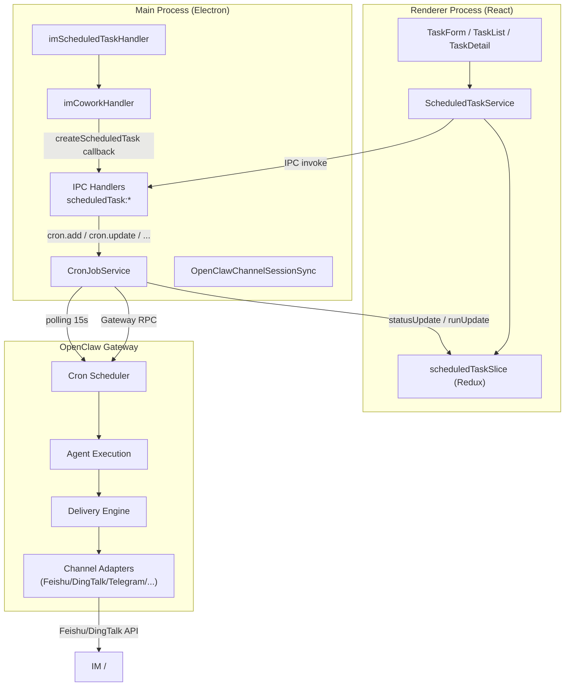

---

##  

---

### 1.   (`src/renderer/types/scheduledTask.ts`)

  Renderer   Main Process   IPC  

#### 1.1 Schedule --  

```typescript
type Schedule =
  | { kind: 'at'; at: string }              //  ISO 8601  
  | { kind: 'every'; everyMs: number; anchorMs?: number }  //  
  | { kind: 'cron'; expr: string; tz?: string; staggerMs?: number }  // Cron  
```

#### 1.2 Payload --  

```typescript
type ScheduledTaskPayload =
  | { kind: 'agentTurn'; message: string; timeoutSeconds?: number }   // Agent  
  | { kind: 'systemEvent'; text: string }                              //  
```

- `agentTurn`  Agent  
- `systemEvent` 

#### 1.3 Delivery --  

```typescript
interface ScheduledTaskDelivery {
  mode: 'none' | 'announce' | 'webhook';
  channel?: string;      // IM  'feishu', 'dingtalk-connector', 'telegram'  
  to?: string;           //   ID   Webhook URL
  accountId?: string;    //  
  bestEffort?: boolean;  //  
}
```

#### 1.4 TaskState --  

```typescript
interface TaskState {
  nextRunAtMs: number | null;
  lastRunAtMs: number | null;
  lastStatus: 'success' | 'error' | 'skipped' | 'running' | null;
  lastError: string | null;
  lastDurationMs: number | null;
  runningAtMs: number | null;
  consecutiveErrors: number;
}
```

#### 1.5  

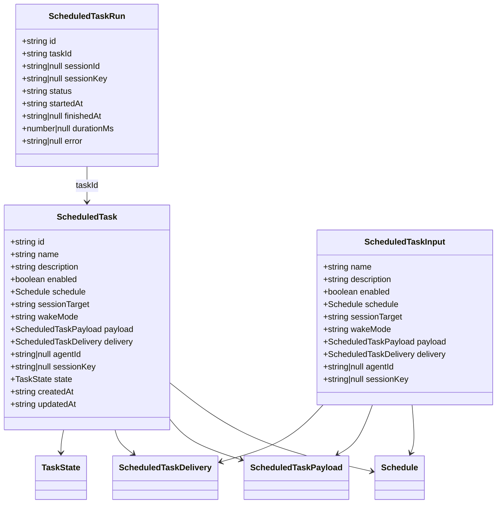

---

### 2.   (`src/common/scheduledTaskPolicies/`)

 

#### 2.1 TaskPolicy  

```typescript
interface TaskPolicy {
  readonly kind: TaskOriginKind;
  getCreateDefaults(origin: TaskOrigin): Partial<PolicyTaskInput>;
  normalizeDraft(draft: PolicyTaskModel): PolicyTaskModel;
  onDeliveryChanged(draft: PolicyTaskModel, newDelivery: PolicyDelivery): PolicyTaskModel;
  toWireBinding(binding: ExecutionBinding): WireBinding;
  describeRunBehavior(task: PolicyTaskModel): string;
  getReadonlyFields(): string[];
}
```

 

|   |   |
|------|------|
| `getCreateDefaults` |   |
| `normalizeDraft` |   |
| `onDeliveryChanged` |   |
| `toWireBinding` |   `ExecutionBinding`   OpenClaw   `sessionTarget`/`sessionKey` |
| `describeRunBehavior` |   |
| `getReadonlyFields` |   UI   |

#### 2.2  

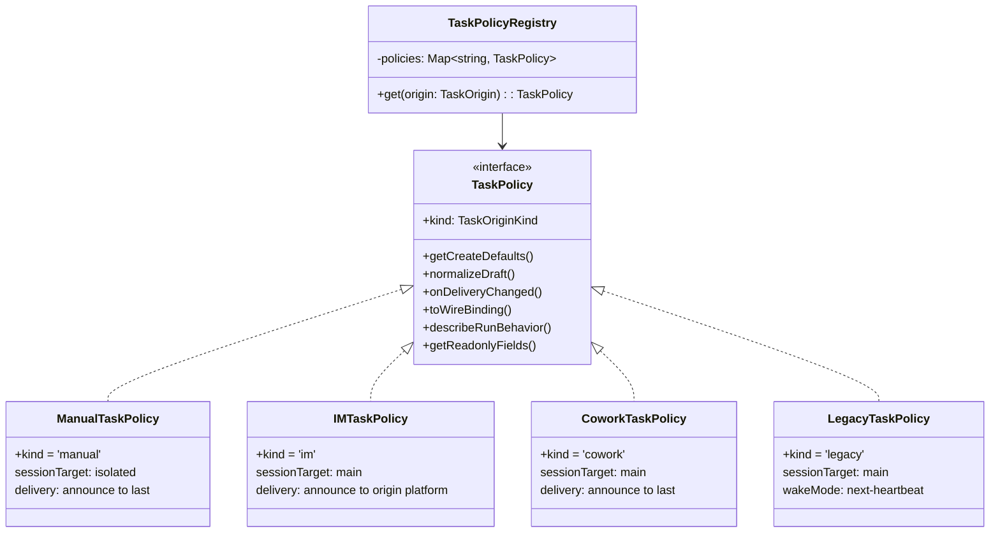

** **

|   | sessionTarget | wakeMode | delivery.mode | delivery.channel |   |
|------|--------------|----------|---------------|-----------------|---------|
| ManualTaskPolicy | `isolated` | `now` | `announce` | `last` |   |
| IMTaskPolicy | `main` | `now` | `announce` |   | `origin` |
| CoworkTaskPolicy | `main` | `now` | `announce` | `last` | `origin` |
| LegacyTaskPolicy | `main` | `next-heartbeat` | -- | -- | `origin` |

**  delivery  **

- **ManualTaskPolicy**  IM   binding   `im_session`  IM   `new_session`
- **IMTaskPolicy**  IM   `none`/`webhook`   `new_session`
- **CoworkTaskPolicy** 
- **LegacyTaskPolicy**  IM   `im_session`  

#### 2.3 TaskPolicyRegistry

```typescript
const taskPolicyRegistry = new TaskPolicyRegistry([
  new LegacyTaskPolicy(),
  new IMTaskPolicy(),
  new CoworkTaskPolicy(),
  new ManualTaskPolicy(),
]);
```

  `registry.get(origin)`   origin  fallback   `ManualTaskPolicy` 

---

### 3.   (`src/common/scheduledTaskOrigin.ts`)

 ** (Origin)** ** (Binding)** 

#### 3.1 TaskOrigin --  

```typescript
type TaskOrigin =
  | { kind: 'legacy' }                                         //  
  | { kind: 'im'; platform: string; conversationId: string }   // IM  
  | { kind: 'cowork'; sessionId: string }                      // Cowork  
  | { kind: 'manual' }                                         // UI  
```

#### 3.2 ExecutionBinding --  

```typescript
type ExecutionBinding =
  | { kind: 'new_session' }                                      //  
  | { kind: 'ui_session'; sessionId: string }                    //   UI  
  | { kind: 'im_session'; platform: string; conversationId: string; sessionId?: string }  // IM  
  | { kind: 'session_key'; sessionKey: string }                  //   sessionKey
```

#### 3.3 inferOriginAndBinding --  

`inferOriginAndBinding()`   `sessionKey`  

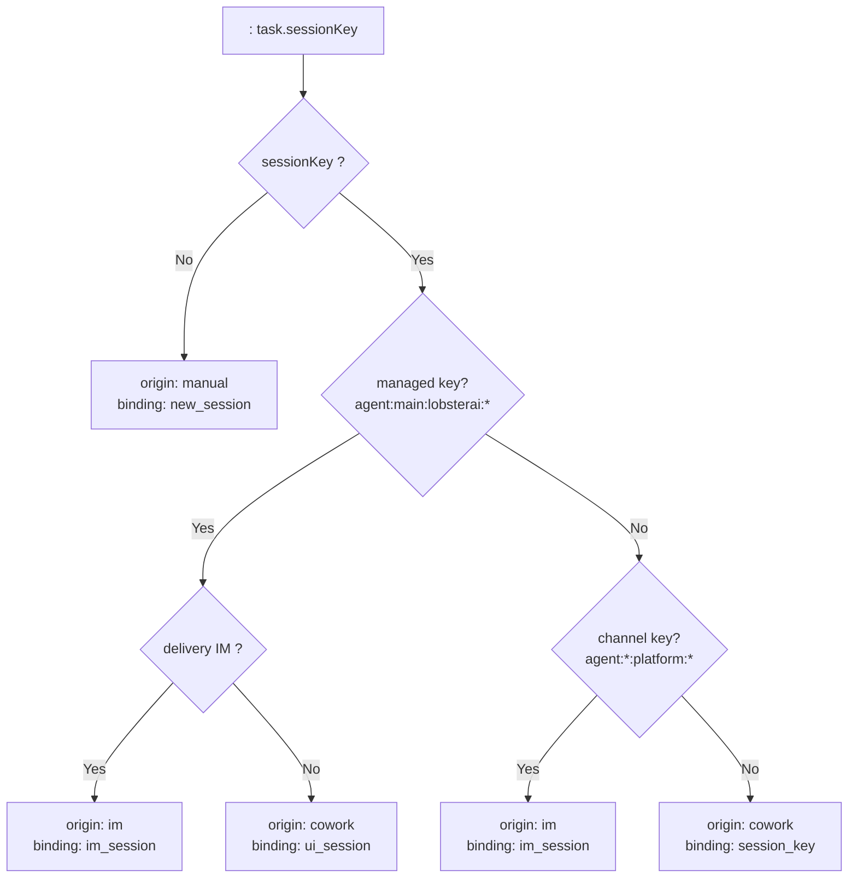

**SessionKey  **

|   |   |   |
|------|------|------|
| `agent:main:lobsterai:{sessionId}` | `agent:main:lobsterai:abc123` |  UI/Cowork   |
| `agent:{agentId}:{platform}:{subtype}:{conversationId}` | `agent:main:feishu:direct:ou_xxx` | IM   |
| `cron:{jobId}` | `cron:job-456` |   Cron   |

---

### 4. TaskModelMapper (`src/common/taskModelMapper.ts`)

 ** (Wire Format)** ** (Domain Model)** 

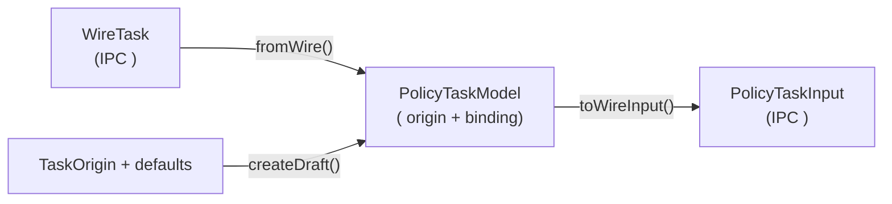

 

|   |   |   |   |
|------|------|------|------|
| `fromWire()` | `WireTask` +   `meta` | `PolicyTaskModel` |   IPC   |
| `toWireInput()` | `PolicyTaskModel` + `TaskPolicy` | `PolicyTaskInput` |   IPC   |
| `createDraft()` | `TaskOrigin` + `defaults` | `PolicyTaskModel` |   |

---

### 5.   (`src/common/scheduledReminderText.ts`)

 

** **

|   |   |   |
|------|------|---------|
|   | `A scheduled reminder has been triggered. The reminder content is: ...` | `parseScheduledReminderPrompt()` |
| Legacy   | `System: [2026-03-21 09:00] ⏰  ` | `parseLegacyScheduledReminderSystemMessage()` |
|   emoji   | `⏰  ` | `parseSimpleScheduledReminderText()` |

  `getScheduledReminderDisplayText()`  

---

### 6. Renderer   -- UI  

#### 6.1  

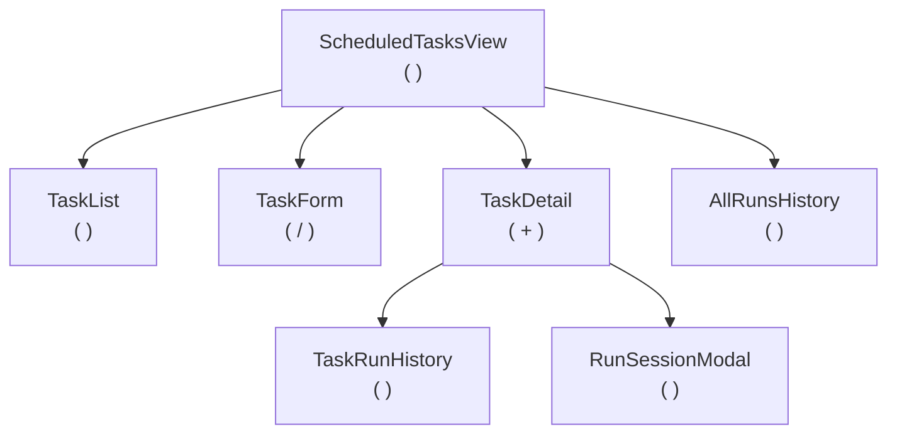

#### 6.2 ScheduledTaskService (`src/renderer/services/scheduledTask.ts`)

  IPC   Redux dispatch 

```typescript
class ScheduledTaskService {
  // CRUD  
  async loadTasks()                          // IPC: scheduledTask:list
  async createTask(input)                    // IPC: scheduledTask:create
  async updateTaskById(id, partial)          // IPC: scheduledTask:update
  async deleteTask(id)                       // IPC: scheduledTask:delete
  async toggleTask(id, enabled)              // IPC: scheduledTask:toggle

  //  
  async runManually(id)                      // IPC: scheduledTask:runManually
  async stopTask(id)                         // IPC: scheduledTask:stop

  //  
  async loadRuns(taskId, limit?, offset?)    // IPC: scheduledTask:listRuns
  async loadAllRuns(limit?, offset?)         // IPC: scheduledTask:listAllRuns
  async listChannels()                       // IPC: scheduledTask:listChannels
  async listChannelConversations(channel)    // IPC: scheduledTask:listChannelConversations
}
```

#### 6.3 Redux Slice (`scheduledTaskSlice.ts`)

```typescript
interface ScheduledTaskState {
  tasks: ScheduledTask[];
  selectedTaskId: string | null;
  viewMode: 'list' | 'create' | 'edit' | 'detail';
  runs: Record<string, ScheduledTaskRun[]>;
  allRuns: ScheduledTaskRunWithName[];
  loading: boolean;
  error: string | null;
}
```

 
- ** ** -> Service   -> IPC   -> dispatch action
- ** ** -> IPC   -> dispatch action `updateTaskState`, `addOrUpdateRun` 

---

### 7. Main Process -- IPC  

#### 7.1 IPC  

  14   `scheduledTask:*` invoke   + 3  

|   |   |   |
|------|------|------|
| `scheduledTask:list` | Request-Reply |   |
| `scheduledTask:get` | Request-Reply |   |
| `scheduledTask:create` | Request-Reply |   IM delivery   |
| `scheduledTask:update` | Request-Reply |   IM delivery   |
| `scheduledTask:delete` | Request-Reply |   |
| `scheduledTask:toggle` | Request-Reply |  /  |
| `scheduledTask:runManually` | Request-Reply |   |
| `scheduledTask:stop` | Request-Reply |  No-op  |
| `scheduledTask:listRuns` | Request-Reply |   |
| `scheduledTask:countRuns` | Request-Reply |   |
| `scheduledTask:listAllRuns` | Request-Reply |   |
| `scheduledTask:resolveSession` | Request-Reply |   |
| `scheduledTask:listChannels` | Request-Reply |   IM   |
| `scheduledTask:listChannelConversations` | Request-Reply |   |
| `scheduledTask:statusUpdate` | Broadcast |   |
| `scheduledTask:runUpdate` | Broadcast |   |
| `scheduledTask:refresh` | Broadcast |   |

#### 7.2 Create/Update   IM Delivery  

  `delivery.mode === 'announce'`   IM  IPC handler  

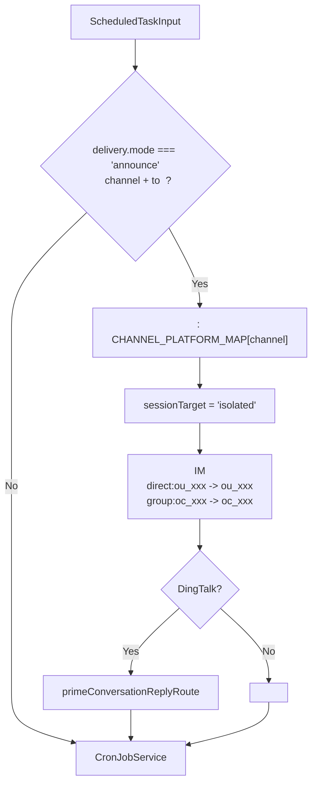

** **

LobsterAI   `imStore`   `conversationId`   IM   `direct:ou_xxx`  `group:oc_xxx`   OpenClaw   `normalizeFeishuTarget()`   `direct:`   `direct:ou_xxx`   API  400   OpenClaw  

---

### 8. CronJobService (`src/main/libs/cronJobService.ts`)

#### 8.1  

`CronJobService`   LobsterAI   OpenClaw Gateway   ** **  Cron RPC  

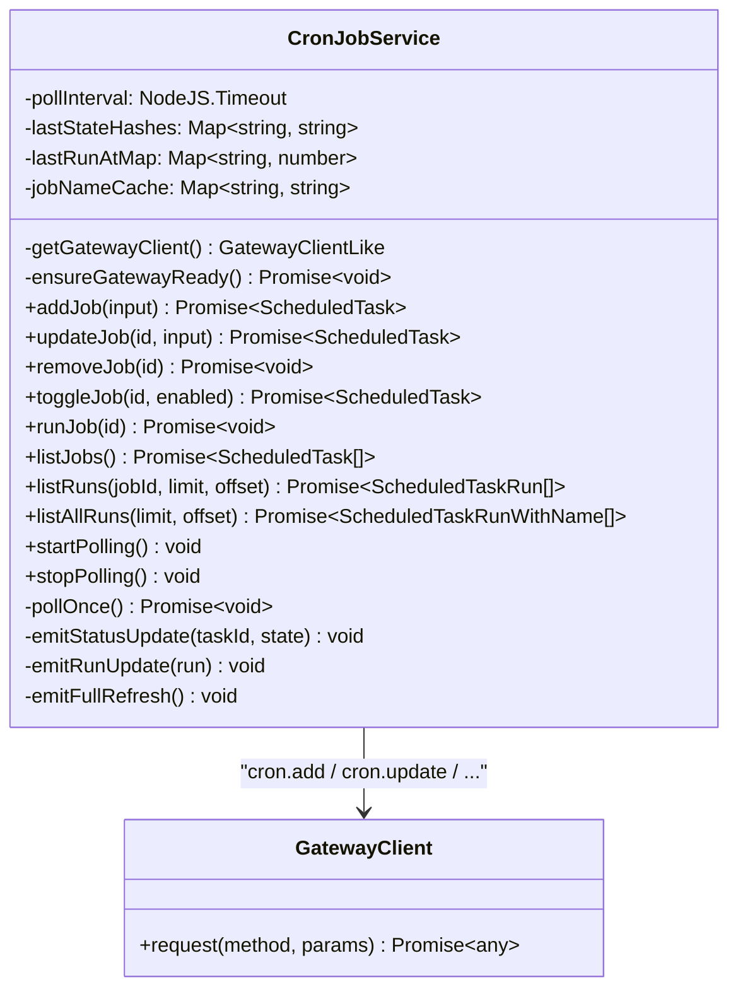

#### 8.2 Gateway RPC  

| CronJobService   | Gateway RPC |   |
|---------------------|------------|------|
| `addJob()` | `cron.add` |   Cron Job |
| `updateJob()` | `cron.update` |   Cron Job patch   |
| `removeJob()` | `cron.remove` |   Cron Job |
| `toggleJob()` | `cron.update` |   enabled   |
| `runJob()` | `cron.run` |   |
| `listJobs()` | `cron.list` |   Job  disabled  |
| `listRuns()` | `cron.runs` |   Job   |
| `listAllRuns()` | `cron.runs` |   |

#### 8.3  

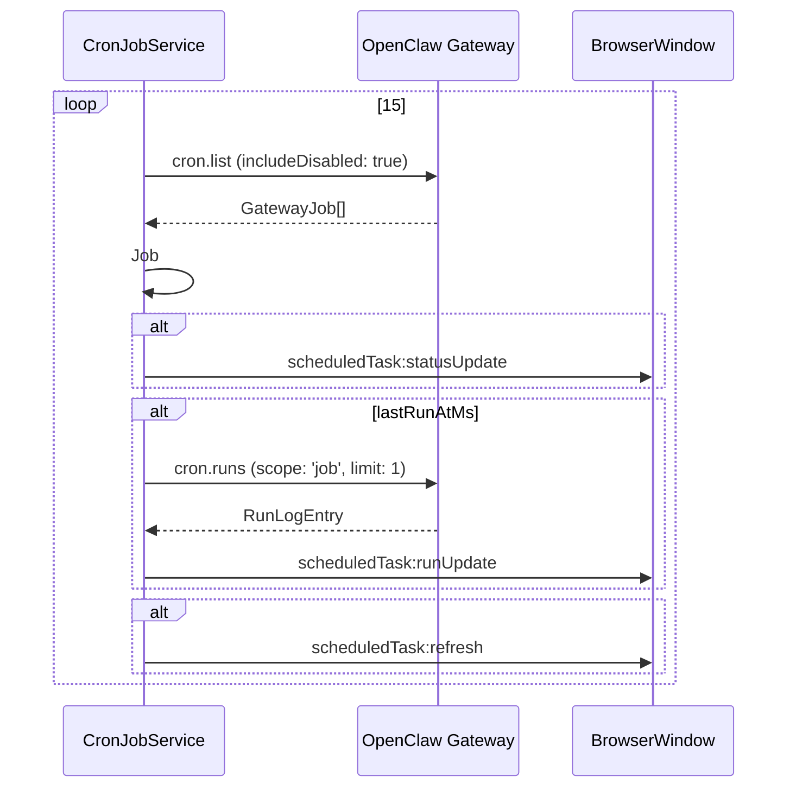

#### 8.4  

CronJobService   LobsterAI   OpenClaw Gateway  

|   | Gateway   |   |
|---------|-------------|---------|
| `Schedule` | `GatewaySchedule` | `mapGatewaySchedule()` / `toGatewaySchedule()` |
| `ScheduledTaskPayload` | `GatewayPayload` | `toGatewayPayload()` |
| `ScheduledTaskDelivery` | `GatewayDelivery` | `toGatewayDelivery()` |
| `TaskState` | `GatewayJobState` | `mapGatewayTaskState()` |
| `ScheduledTask` | `GatewayJob` | `mapGatewayJob()` |

---

### 9. IM   (`src/main/im/imScheduledTaskHandler.ts`)

#### 9.1  

  IM  

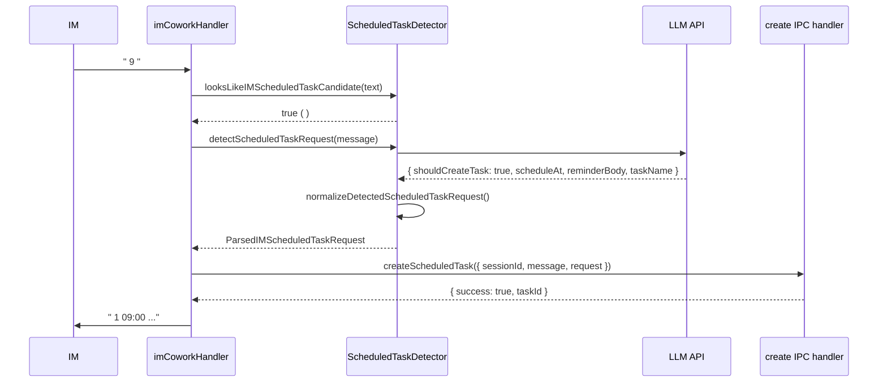

#### 9.2  

1. ** ** (`looksLikeIMScheduledTaskCandidate`) ` `, ` `, ` `, `remind`, `schedule`, `tomorrow`  
2. **LLM  **  LLM   `{ shouldCreateTask, scheduleAt, reminderBody, taskName }`
3. ** ** (`normalizeDetectedScheduledTaskRequest`) 

#### 9.3 IM  

 `imCoworkHandler`   Cowork  

```
[USER]       " 9 "
[TOOL_USE]   { toolName: "cron", action: "add", job: { name, schedule, payload } }
[TOOL_RESULT] { id, name, agentId, sessionKey, payloadText, scheduleAt }
[ASSISTANT]  " 1 09:00 ..."
```

---

### 10.   (`src/main/libs/openclawChannelSessionSync.ts`)

#### 10.1 SessionKey  

OpenClaw   `sessionKey`  LobsterAI  

|   |   |   |   |
|------|------|------|------|
|   | `agent:{agentId}:lobsterai:{sessionId}` | `agent:main:lobsterai:abc123` | UI/Cowork   |
|   | `agent:{agentId}:{platform}:{subtype}:{conversationId}` | `agent:main:feishu:direct:ou_xxx` | IM   |
| Cron   | `cron:{jobId}` | `cron:job-456` |   Cron   |

#### 10.2  

```typescript
const CHANNEL_PLATFORM_MAP: Record<string, IMPlatform> = {
  'dingtalk-connector': 'dingtalk',
  'feishu': 'feishu',
  'telegram': 'telegram',
  'discord': 'discord',
  'netease-im': 'netease-im',
  'netease-bee': 'netease-bee',
};

const PLATFORM_TO_CHANNEL_MAP: Record<IMPlatform, string> = {
  'dingtalk': 'dingtalk-connector',
  'feishu': 'feishu',
  'telegram': 'telegram',
  'discord': 'discord',
  'netease-im': 'netease-im',
  'netease-bee': 'netease-bee',
};
```

#### 10.3 delivery.to  

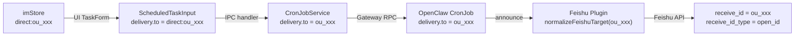

---

### 11. OpenClaw Cron  

OpenClaw Gateway   Cron  Agent  

#### 11.1 Cron Job  

```typescript
interface CronJob {
  id: string;
  name: string;
  description?: string;
  enabled: boolean;
  schedule: CronSchedule;           // at | every | cron
  sessionTarget: 'main' | 'isolated';
  wakeMode: 'now' | 'next-heartbeat';
  payload: CronPayload;            // systemEvent | agentTurn
  delivery?: CronDelivery;         // announce | webhook | none
  failureAlert?: CronFailureAlert;
  agentId?: string | null;
  sessionKey?: string | null;
  deleteAfterRun?: boolean;        //  
  state: CronJobState;
  createdAtMs: number;
  updatedAtMs: number;
}
```

#### 11.2  

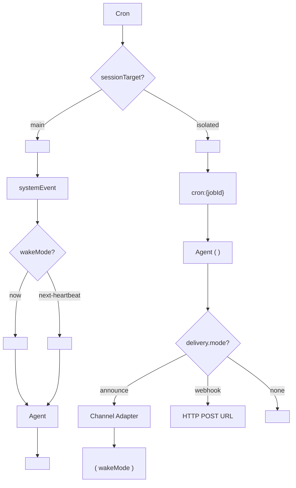

#### 11.3 Announce  

  `delivery.mode = 'announce'`  

1. **Channel  **  `delivery.channel`   Channel Adapter Feishu DingTalk Telegram  
2. ** ** `delivery.to`   ID  ID Webhook URL  
3. ** **  IM  
4. ** ** 
5. ** ** `HEARTBEAT_OK` 
6. ** **  `wakeMode`  

#### 11.4  

** **
-   (429)
-   (timeout, ECONNRESET)
-   (5xx)

** **
-  API Key  
-  / 

** **

|   |   |   |   |
|---------|---------|---------|-----------|
|   (`at`) |   3   | 30s -> 1m -> 5m |   |
|   (`cron`/`every`) |   | 30s -> 1m -> 5m -> 15m -> 60m |   |

#### 11.5  

|   |   |   |
|-------|------|---------|
| Job   | `~/.openclaw/cron/jobs.json` |   |
|   | `~/.openclaw/cron/runs/{jobId}.jsonl` | `runLog.maxBytes` (2MB) + `runLog.keepLines` (2000) |
|   | OpenClaw sessions | `sessionRetention` (  24h) |

** ** `schedule.kind = at`   OpenClaw  
`deleteAfterRun = true`  Job  
 

---

##  

###  UI   +  

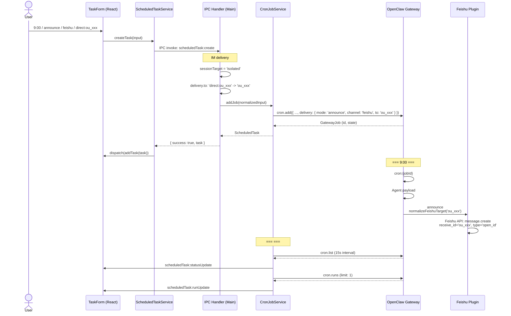

###  

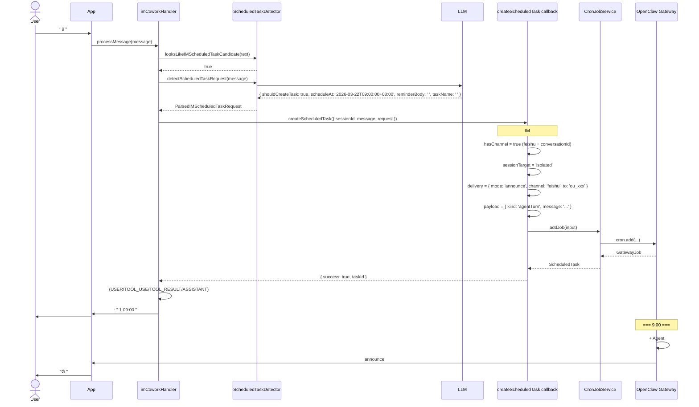

---

##  

LobsterAI  

1. ** Renderer **  UI   CRUD   Redux +  
2. ** Main Process **  IPC handler + CronJobService   IM delivery  
3. ** OpenClaw Gateway **  LobsterAI  

** **

|   |   |
|------|------|
|   |   if-else |
|   |   sessionKey   OpenClaw   |
|   OpenClaw | LobsterAI   `imStore`   ID   OpenClaw   Feishu   OpenClaw   |
| 15   WebSocket | OpenClaw Gateway   |
| `isolated` + `announce`   IM   |  announce   OpenClaw   OpenClaw   |
